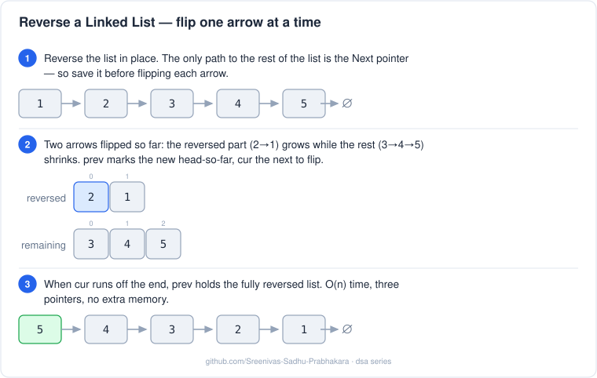

# Reverse a Linked List

> Striver SDE Sheet 025 · Day 5 Linked List — iterative three-pointer reversal: flip one `Next` at a time, O(1) space. Go, stdlib only, tested.

## Problem

Reverse a singly linked list and return the new head. The canonical pointer-surgery exercise: no array copy, no recursion-stack space.

## Approach

Walk the list once holding three references — the node behind (`prev`), the current node, and a saved `next`. Each step redirects `cur.Next` to point backwards, then both pointers advance. Saving `next` before the redirect is the whole trick: the forward link is the only path to the rest of the list, and flipping it unsaved would orphan everything beyond. When `cur` runs off the end, `prev` is the new head. (The recursive version is prettier and O(n) stack; this one is the production answer.)

**Complexity:** O(n) time, O(1) space.

## Visual walkthrough

Read the picture top to bottom — each numbered frame is one moment of the algorithm
running on this repo's test example.

## Run

    go test ./...   # verify
    go run .        # demo

---

One of 191 repos solving Striver's SDE Sheet in Go — stdlib only, one problem per repo, every solution tested. Browse the set: [`dsa-*` repos](https://github.com/Sreenivas-Sadhu-Prabhakara?tab=repositories&q=dsa-&type=source).
